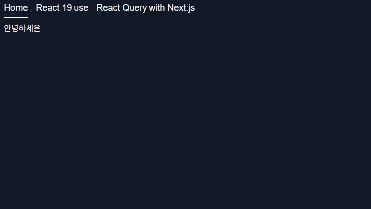

# 시나리오

- 해당 페이지는 json.placeholder 사이트에서 제공하는 todos 데이터 목록을 가져오는 페이지다.
- 클라이언트 컴포넌트는 id 값 증가, 감소 버튼을 통해 `todos?id={id}` 값에 해당하는 데이터를 불러온다.
- 이 때 이전에 가져온 id 의 값은 캐싱되어 불필요한 데이터 재요청을 방지한다.
- 프리페칭이 일어나는 동안엔 Suspense 를 통해 로딩 상태를 보여줘야 한다.

# 내부 구현 탐구 전 사용 예시 살펴보기

우선 코드 내부를 살펴 보기전 실제 사용 예시를 살펴보자



```tsx
export const Page = () => {
  return (
    <section>
      <Suspense fallback={<div>loading...</div>}>
        <ServerTodoComponent>
          <ClientTodoFlipper />
        </ServerTodoComponent>
      </Suspense>
      ...
    </section>
  );
};

const ServerTodoComponent: React.FC<PropsWithChildren> = async ({
  children,
}) => {
  const DEFAULT_TODO_ID = 1;
  const queryClient = new QueryClient();

  await queryClient.prefetchQuery({
    queryKey: ["todo", DEFAULT_TODO_ID],
    queryFn: () => getTodoById(DEFAULT_TODO_ID),
  });

  return (
    <HydrationBoundary state={dehydrate(queryClient)}>
      {children}
    </HydrationBoundary>
  );
};
```

> 현재 서버 컴포넌트는 리액트 쿼리의 예시처럼 `prefetch` 가 완전히 실행 되기 전까지 렌더링을 `awaited` 하고 있다.
>
> 이후 설명에서 왜 그런지, 또 어떻게 하면 기다리지 않아도 되는지 설명한다.

```tsx
"use client";

export const ClientTodoFlipper: React.FC = () => {
  const [searchingTodoId, setSearchingTodoId] = useState(1);
  const { data } = useSuspenseQuery({
    queryKey: ["todo", searchingTodoId],
    queryFn: () => getTodoById(searchingTodoId),
  });

  ...

  return (
    ...
  );
};
```

위 예시를 보면 서버에서 `QueryClient` 를 생성하여 (이하 서버 쿼리 클라이언트) 서버 쿼리 클라이언트에서 데이터를 `prefetch` 하고

`prefetch` 를 완료한 서버 쿼리 클라이언트를 `HydrationBoundary` 에 `dehydrate(서버 쿼리 클라이언트)` 를 전달 하는 모습을 볼 수 있다.

이후 클라이언트(브라우저)에서 생성한 쿼리 클라이언트 (이하 브라우저 쿼리 클라이언트)로 시행되는 `useQuery` 를 이용해 데이터를 패칭한다.

즉, 위 예시에서 흐름은

1. 서버 단에서 서버 쿼리 클라이언트로 `id=1` 에 대한 데이터 요청
2. 데이터 요청이 완료되고 나면 `ClientTodoFlipper` 컴포넌트 렌더링
3. 클라이언트에서 렌더링된 `ClientTodoFlipper` 컴포넌트는 서버에서 `prefetch` 해둔 데이터를 이용해 api 요청 없이 렌더링

으로 일어나게 된다.

사실 나는 깃허브에서 코드 내부를 살펴보기 전 까지 도대체 저게 어떻게 가능한지 감을 잡기 힘들었다.

서버 쿼리 클라이언트와 브라우저 쿼리 클라이언트는 분명 서로 다른 인스턴스인데

어떻게 서버 쿼리 클라이언트의 데이터가 쿼리 클라이언트로 전달 될 수 있을까? 하고 말이다.

다만 내부 코드 구현 사항을 보면 생각보다 간단하게 구현 되어 있는 모습을 볼 수 있다.

# HydrationBoundary 의 동작 원리

`HydrationBoundary` 컴포넌트는 위에서 말한 `Dehydration , Hydration` 과정을 추상화 해둔 컴포넌트이다.

클라이언트 상에서 사용 할 `queryClient` 를 제공하는 컨텍스트 내부에 존재해야 한다.

[query/packages/react-query/src/HydrationBoundary.tsx at main · TanStack/query](https://github.com/TanStack/query/blob/main/packages/react-query/src/HydrationBoundary.tsx)

```tsx
'use client'

export const HydrationBoundary = ({
  children,
  options = {},
  state, // <- dehydrate(서버 쿼리 클라이언트)
  queryClient,
}: HydrationBoundaryProps) => {
  // 1. 브라우저상에 존재하는 쿼리 클라이언트를 가져옴
  const client = useQueryClient(queryClient);

  const [hydrationQueue, setHydrationQueue] = React.useState<
    DehydratedState["queries"] | undefined
  >();

  const optionsRef = React.useRef(options);
  optionsRef.current = options;

  React.useMemo(() => {
    // 서버 쿼리 클라이언트에서 페칭 한 어떤 데이터가 존재 한다면
    if (state) {
      ...

      // 브라우저 쿼리 클라이언트의 캐싱된 데이터
      const queryCache = client.getQueryCache();

      // 서버 쿼리 클라이언트의 쿼리 데이터를 담은 배열
      const queries = (state as DehydratedState).queries || [];

      // 브라우저 쿼리 클라이언트에는 없지만 서버 쿼리 클라이언트에는 존재하는 쿼리들을 담을 배열
      const newQueries: DehydratedState["queries"] = [];

      // 브라우저 쿼리 클라이언트에도 있고 서버 쿼리 클라이언트에도
      // 존재하는 쿼리들을 담을 배열
      const existingQueries: DehydratedState["queries"] = [];


      for (const dehydratedQuery of queries) {
        // 브라우저 쿼리 클라이언트에 존재하니 않는 쿼리는
        // newQueries 에 추가
        const existingQuery = queryCache.get(dehydratedQuery.queryHash);

        if (!existingQuery) {
          newQueries.push(dehydratedQuery);
        }
        else {
          // 브라우저 쿼리 클라이언트에 존재하지만
          // 서버 쿼리 클라이언트에서 생성된 쿼리가 더 fresh 하다면
          //  existingQueries 배열에 추가
          const hydrationIsNewer =
            dehydratedQuery.state.dataUpdatedAt >
            existingQuery.state.dataUpdatedAt;
          const queryAlreadyQueued = hydrationQueue?.find(
            (query) => query.queryHash === dehydratedQuery.queryHash
          );

          if (
            hydrationIsNewer &&
            (!queryAlreadyQueued ||
              dehydratedQuery.state.dataUpdatedAt >
                queryAlreadyQueued.state.dataUpdatedAt)
          ) {
            existingQueries.push(dehydratedQuery);
          }
        }
      }

      // 클라이언트 상에 존재하지 않는 쿼리는
      // 즉각적으로 hydrate
      if (newQueries.length > 0) {
        hydrate(client, { queries: newQueries }, optionsRef.current);
      }
      // 업데이트가 필요한 쿼리는 (서버에서 제공한 쿼리문이 더 fresh 한 경우) Effect를 통해 hydration
      if (existingQueries.length > 0) {
        setHydrationQueue((prev) =>
          prev ? [...prev, ...existingQueries] : existingQueries
        );
      }
    }
  }, [client, hydrationQueue, state]);

  React.useEffect(() => {
    if (hydrationQueue) {
      hydrate(client, { queries: hydrationQueue }, optionsRef.current);
      setHydrationQueue(undefined);
    }
  }, [client, hydrationQueue]);

  return children as React.ReactElement;
};
```

내부 코드 구현 사항을 보면 단순히 인수로 받은 서버 쿼리 클라이언트안에 저장 된

쿼리값들을 이용해 브라우저 쿼리 클라이언트 쿼리 캐시에 쿼리들을 추가하는 과정을 거친다.

안에서 사용되는 `dehydrate , hydrate` 의 내부 구현도 생각보다 상당히 심플한데 전체 코드는 [query/packages/query-core/src/hydration.ts at ebe996d70dd46b4f3c926b3cc9671a88bfdae349 · TanStack/query](https://github.com/TanStack/query/blob/ebe996d70dd46b4f3c926b3cc9671a88bfdae349/packages/query-core/src/hydration.ts#L178) 에서 살펴보도록 하고 단순히 기능만 적어보자면 다음과 같다.

- `dehydrate` : 인수로 받은 쿼리 클라이언트에서 `dehydrate : ..` 옵션에 존재하는 `shouldDehydrateQuery` 콜백 메소드의 반환값에 따라 쿼리들을 직렬화한다. 만약 쿼리 옵션에 `shouldDehydrateQuery` 를 설정하지 않았다면 요청이 성공한 쿼리들에 대해서만 직렬화 하여 반환
  (만약 직렬화 할 메소드를 제공하지 않으면 그대로 전달)

- `hydration` : 인수로 받은 쿼리 클라이언트에서 데이터를 역직렬화 하여 쿼리 클라이언트의 쿼리를 업데이트 한다. (만약 역직렬화 할 메소드를 제공하지 않았다면 그대로 업데이트)

> 이렇게 문자로 보면 조금 복잡해 보이는데 실제 코드 구현을 보면 무지무지 심플하다.
>
> 그냥 단순히 `dehydrate` 메소드는 인수로 받은 쿼리 클라이언트 내부 쿼리, 뮤테이션들을 `dehydrate` 시킬걸로 필터링 하고, 인수로 받은 직렬화 메소드에 따라 메소드 한 `query , mutation` 을 반환한다.
>
> `hydrate` 는 인수로 받은 DehydrateState(dehydrate의 반환 값) 내부 쿼리, 뮤테이션들을 `dehydrate` 시켰던 걸로 필터링 하고, 필터링 된 쿼리, 뮤테이션들을 인수로 받은 역직렬화 메소드로 역직렬화 , 이후 인수로 받은 쿼리클라이언트 내부 데이터 업데이트

**결국 Hydration 이란 브라우저 쿼리 클라이언트 내부 쿼리보다 fresh한 쿼리로 서버 쿼리 클라이언트의 쿼리로 업데이트** 하는 것이다.

이래서 인수로 쿼리 클라이언트 자체를 넘겨주었구나 , 쿼리 클라이언트 내부 쿼리들의 데이터를 이용해 비교하고 수정하기 때문에 말이다.

# 옵션을 만져서 좀 더 위 컴포넌트를 발전시켜 보자

```tsx
export const Page = () => {
  return (
    <section>
      <Suspense fallback={<div>loading...</div>}>
        <ServerTodoComponent>
          <ClientTodoFlipper />
        </ServerTodoComponent>
      </Suspense>
      ...
    </section>
  );
};

const ServerTodoComponent: React.FC<PropsWithChildren> = async ({
  children,
}) => {
  const DEFAULT_TODO_ID = 1;
  const queryClient = new QueryClient();

  await queryClient.prefetchQuery({
    queryKey: ["todo", DEFAULT_TODO_ID],
    queryFn: () => getTodoById(DEFAULT_TODO_ID),
  });

  return (
    <HydrationBoundary state={dehydrate(queryClient)}>
      {children}
    </HydrationBoundary>
  );
};
```

자 현재 서버 컴포넌트의 흐름을 보면 서버 단에서 `prefetch` 가 완료되기 전까지 클라이언트 컴포넌트는 렌더링 되지 않는다.

`prefetch` 가 완료되기 전 까지 `await` 하고 있기 때문이다.

```tsx
    <HydrationBoundary state={dehydrate(queryClient)}>
```

좀 더 고도화 시키기 전에 `dehydrate` 내부 코드를 아주 조금만 까보자

```tsx
export function defaultShouldDehydrateQuery(query: Query) {
  return query.state.status === 'success'

}
function defaultTransformerFn(data: any): any {
  return data
}

export function dehydrate(
  client: QueryClient,
  options: DehydrateOptions = {},
): DehydratedState {
  ...

  const filterQuery =
    options.shouldDehydrateQuery ??
    client.getDefaultOptions().dehydrate?.shouldDehydrateQuery ??
    defaultShouldDehydrateQuery

  const serializeData =
    options.serializeData ??
    client.getDefaultOptions().dehydrate?.serializeData ??
    defaultTransformerFn

  const queries = client
    .getQueryCache()
    .getAll()
    .flatMap((query) =>
      filterQuery(query) ? [dehydrateQuery(query, serializeData)] : [],
    )

  return { mutations, queries }
}
```

`hydrate` 시키기 위한 `queries , mutation` 데이터를 필터링 할 때

인수로 받은 쿼리 클라이언트에 설정된 `dehydrate` 내부 옵션에 따라 `hydrate` 시킬 쿼리를 필터링 한다.

현재는 아무런 옵션도 주지 않고 있으니 `query.state.status === success` 에만 해당하는 쿼리만 브라우저 쿼리클라이언트에게만 전달 될 것이다.

`query.state.status` 의 상태를 확인해야 하니 `prefetch` 하는 동안 `await` 하고 있어야 하는데

옵션을 다음과 같이 변경해주면 그럴 필요가 없다.

```tsx
const ServerTodoComponent: React.FC<PropsWithChildren> = ({ children }) => {
  const DEFAULT_TODO_ID = 1;
  const queryClient = new QueryClient({
    defaultOptions: {
      queries: {
        staleTime: 1000 * 60 * 5,
      },
      dehydrate: {
        shouldDehydrateQuery: (query) =>
          query.state.status === "pending" ||
          // defaultShould .. 이건 그냥 query => query.state.status === `success`
          defaultShouldDehydrateQuery(query),
      },
    },
  });

  // 더 이상 prefetch 의 결과를 기다리지 않아도 됨
  queryClient.prefetchQuery({
    queryKey: ["todo", DEFAULT_TODO_ID],
    queryFn: () => getTodoById(DEFAULT_TODO_ID),
  });

  return (
    <HydrationBoundary state={dehydrate(queryClient)}>
      {children}
    </HydrationBoundary>
  );
};
```

이렇게 하게 되면 더 이상 `prefetch` 의 실행 유무와 상관 없이 더 이상 `await` 하지 않고 클라이언트 컴포넌트가 렌더링 되게 된다.

짝짝짝

# 내용 업데이트, 서버 컴포넌트는 완벽한 마크업을 생성하자

> 2025.02.03 업데이트

위에서 빠르게 마크업 결과를 전송하기 위해 서버단에서 api 데이터를 기다리지 않고

바로 렌더링을 완료하도록 하는것이 발전된 방향이라고 이야기했다.

하지만 이는 사실이 아니다. 만약 이렇게 하게 된다면 서버 컴포넌트를 사용하여 얻는 이점인

**완성된 HTML 파일을 통한 SEO 최적화** 라는 장점을 이용하지 못하게 된다.

실제 위 코드 예시를 봐보자


서버단에서 마크업을 생성 할 때 데이터를 기다리지 않고 생성하게 되니 이게 뭐람

데이터 없이 `loading` 이란 상태만 나타나는 모습을 볼 수 있다.

```tsx
const ServerTodoComponent: React.FC<PropsWithChildren> = async ({
  children,
}) => {
  const DEFAULT_TODO_ID = 1;
  const queryClient = new QueryClient();

  await queryClient.prefetchQuery({
    queryKey: ["todo", DEFAULT_TODO_ID],
    queryFn: () => getTodoById(DEFAULT_TODO_ID),
  });

  return (
    <HydrationBoundary state={dehydrate(queryClient)}>
      {children}
    </HydrationBoundary>
  );
};
```

완성된 마크업을 생성 할 수 있도록 서버에서 데이터를 가져오는 것을 `await` 해주도록 하자

> 흠 .. 선택하기 나름인걸까? SEO 와 더 빠른 속도 ?
>
> 그런데 아무리 생각해도 SEO 를 포기하는 것은 올바르지 않은 것 같아서 나는 위처럼 사용 할 예정이다.
