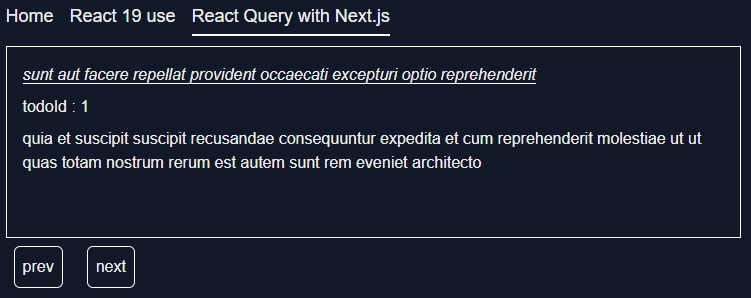

# 시나리오

- 해당 페이지는 json.placeholder 사이트에서 제공하는 todos 데이터 목록을 가져오는 페이지다.
- 클라이언트 컴포넌트는 id 값 증가, 감소 버튼을 통해 `todos?id={id}` 값에 해당하는 데이터를 불러온다.
- 이 때 이전에 가져온 id 의 값은 캐싱되어 불필요한 데이터 재요청을 방지한다.
  - **prefetch 요구 사항**
    - MainNavigationBar에 마우스를 hover 하면 id=1 에 해당하는 todos 데이터를 **서버에서 프리페칭 하고 캐싱**한다.
    - 클라이언트 컴포넌트에서 id 증가, 감소 버튼에 마우스를 hover 하면 **클라이언트에서 프리페칭 하고 캐싱**한다.
    - 프리페칭이 일어나는 동안엔 Suspense 를 통해 로딩 상태를 보여줘야 한다.

# 기본적인 컴포넌트 구조



```tsx
// 서버 컴포넌트
import { ReactQueryWithNextJsScenario, TodoFlipper } from "../widgets";
import { getTodoById } from "../api";

export const Page = async () => {
  const todo = await getTodoById(1);

  return (
    <section>
      <TodoFlipper todo={todo} />
      <ReactQueryWithNextJsScenario />
    </section>
  );
};
```

```tsx
"use client";

interface TodoFlipperProps {
  todo: Todo;
}

export const TodoFlipper: React.FC<TodoFlipperProps> = ({ todo }) => {
  const [searchingTodoId, setSearchingTodoId] = useState(1);

  const handlePrev = () => {
    setSearchingTodoId((prev) => (prev - 1 > 0 ? prev : prev - 1));
  };

  const handleNext = () => setSearchingTodoId((prev) => prev + 1);

  return (
    <section>
      <CurrentTodo {...todo} />
      <div className="flex gap-2">
        <TodoFlipperButton onClick={handlePrev}> prev </TodoFlipperButton>
        <TodoFlipperButton onClick={handleNext}> next </TodoFlipperButton>
      </div>
    </section>
  );
};

const TodoFlipperButton: React.FC<
  React.ButtonHTMLAttributes<HTMLButtonElement>
> = ({ onClick, children }) => (
  <button className="border border-white p-2 m-2 rounded-md" onClick={onClick}>
    {children}
  </button>
);
```

다음과 같이 서버에서 데이터를 불러와 렌더링을 통해 마크업을 생성 한 후

클라이언트 컴포넌트 단에서 `getTodoById`의 인수에 해당되는 `id` 를 변경함으로서

다른 데이터를 동적으로 불러와야 하는 경우를 생각해보자

## 리액트 쿼리를 도입하면 props로 데이터를 받아올 필요가 없다.

리액트 쿼리는 `QueryClientProvider` 를 통해 컨텍스트 내부에 존재하는 모든 컴포넌트들이 동일한 `queryClient` 를 공유하기 때문에

'queryKey`만으로 데이터를 불러와 사용 할 수 있기 때문에 `props drilling` 문제에서 자유로워질 수 있다.
